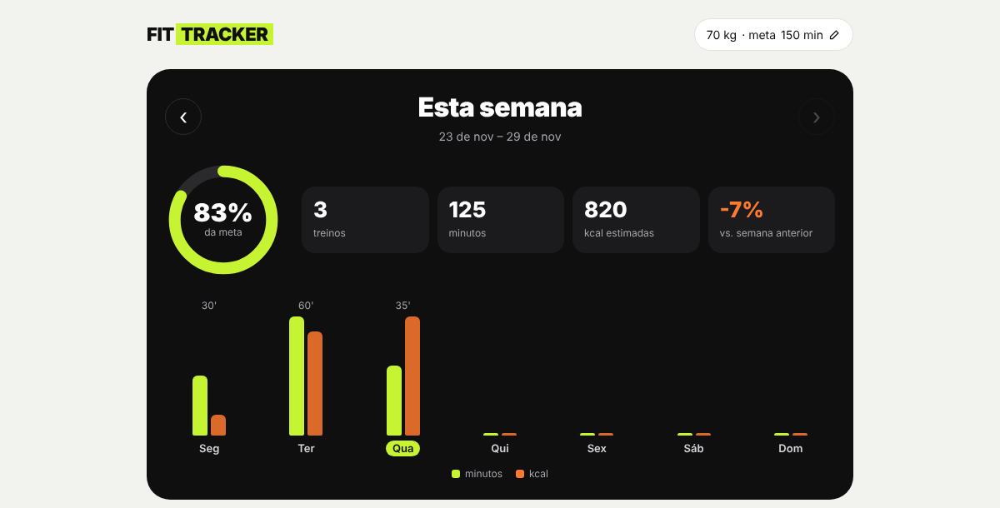

# FitTracker — Registro de treinos

Registre seus treinos diários, veja o histórico da semana e as calorias estimadas de cada atividade.

🔗 **[Ver o site no ar](https://iamviniciuslima05.github.io/PROJETO-FitTracker/)**



## Funcionalidades

- Registro de treinos com **atividade, duração, intensidade** e observações
- **Calorias estimadas** pela fórmula MET × peso × horas
- **Gráfico da semana** com minutos e calorias por dia
- **Meta semanal** de minutos com anel de progresso
- Comparação com a **semana anterior**
- Navegação entre semanas
- Ranking das **atividades mais praticadas**
- Excluir com **desfazer**

## Tecnologias

HTML5 · CSS3 · JavaScript · localStorage

## Estrutura

```
index.html
css/style.css
js/script.js
```

## Como rodar

Não precisa instalar nada: baixe o projeto e abra o `index.html` no navegador, ou acesse a versão publicada acima.

---
Feito por **Vinicius Lima** · [Portfólio](https://viniciuslimadev.netlify.app) · [LinkedIn](https://www.linkedin.com/in/viniciuslima25/)
